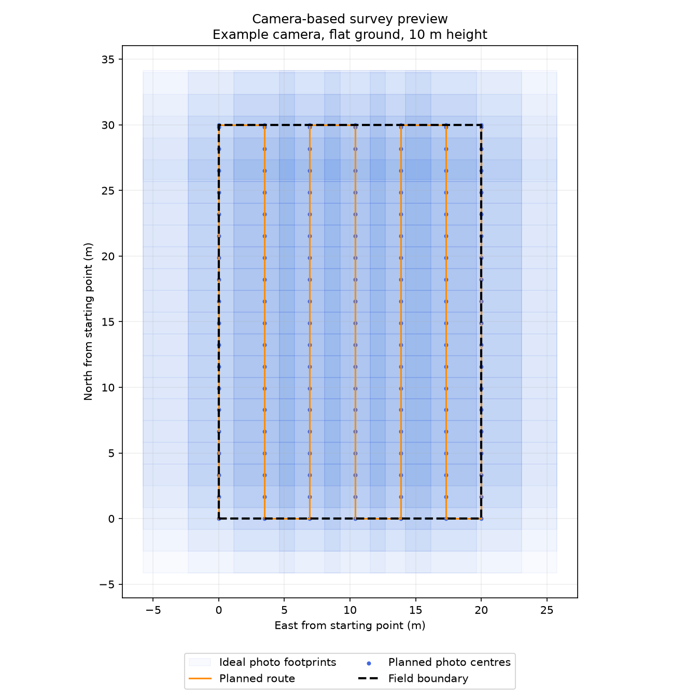
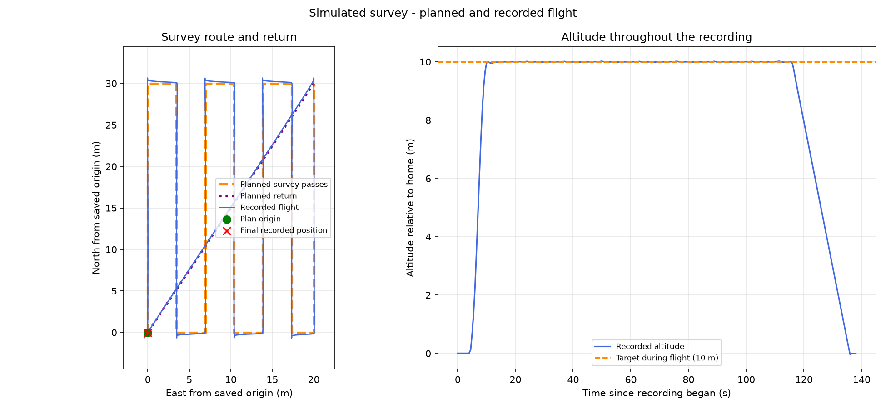

# Autonomous Drone Survey Mission in ArduPilot SITL

A Python application that plans and executes a simulated field-survey flight, records MAVLink telemetry, generates simulated camera-trigger events, and evaluates the resulting flight and capture spacing.

The project runs on a Windows laptop using Mission Planner, ArduPilot Software-in-the-Loop (SITL), and pymavlink. It demonstrates companion-computer-style mission logic running on the laptop. No physical drone, onboard computer, or camera was used.

## What the project does

- Generates a back-and-forth survey route from field dimensions, camera field of view, altitude, and overlap assumptions.
- Connects to the simulated autopilot and filters telemetry by vehicle system/component IDs.
- Requests Guided mode, arms, takes off, follows survey destinations, returns to the origin, and lands.
- Confirms flight states using telemetry and uses bounded waits.
- Logs position, altitude, mission phase, and destination to CSV.
- Records simulated photo events based on distance travelled during straight survey passes.
- Compares recorded flight paths with planned routes and calculates selected tracking-error metrics.
- Evaluates event spacing and estimated forward overlap.
- Handles a keyboard interruption by requesting LAND and retaining an incomplete mission result.

Python sends destinations and supervisory commands; ArduPilot performs flight stabilization and position control. The application does not implement a low-level flight controller.

## System flow

```text
Camera assumptions + field dimensions
                |
                v
       Python survey planner
                |
                v
        Survey plan CSV
                |
                v
 Python mission application <---- MAVLink ----> ArduCopter SITL
                |                                  |
                v                                  v
   Flight log + photo-event log              Mission Planner
                |
                v
       Analysis and reports
```

Photo events are software records. They do not send camera capture commands or generate photographs.

## Demonstrated configuration

| Item | Value |
|---|---|
| Operating system | Windows |
| Python | 3.13 |
| Ground station | Mission Planner 1.3.83 |
| Autopilot shown during testing | ArduCopter 4.8.0-dev |
| Python libraries | pymavlink, matplotlib |
| Python telemetry endpoint | `udpin:127.0.0.1:14600` |
| Expected autopilot IDs | System 1, component 1 |
| Field | 30 m north by 20 m east |
| Flight height | 10 m relative to home |
| Camera geometry | Example 60-degree cross-track and 45-degree along-track FOV |
| Requested overlap | 70% side overlap; 80% forward overlap |
| Survey passes | 7 |
| Nominal maximum photo spacing | Approximately 1.657 m |
| Improved event trigger threshold | Approximately 1.257 m |

Camera geometry assumes flat ground at home elevation, a downward-facing camera, and fixed footprint axes aligned east/north. Flight height relative to home is not generally the same as height above terrain.

## Main files

| File | Purpose |
|---|---|
| `plan_camera_survey.py` | Generate route, ideal photo centres, geometry settings, and preview |
| `survey_photo_events_improved.py` | Execute the survey and log events with the earlier trigger |
| `analyze_photo_events_improved.py` | Analyse the most recently saved photo-run result |
| `survey_photo_events.py` | Baseline event-trigger implementation |
| `survey_measured.py` | Earlier flight used for tracking-error measurement |
| `analyze_survey.py` | Analyse labelled straight survey passes |
| `plot_survey.py` | Earlier route/altitude plotting script; inspect its selected run before use |
| `RESULTS.md` | Recorded test results, interpretation, and limitations |

Generated data is stored in `plans/`, `logs/`, `plots/`, and `reports/` as applicable. Each flight uses a timestamp to pair its flight CSV, event CSV, executed-plan CSV, and result JSON.

## Setup on Windows

If the project already works on your laptop, keep your existing environment and skip installation.

For a new checkout, open PowerShell in the project folder and run these commands separately:

```powershell
py -3.13 -m venv .venv
```

```powershell
.\.venv\Scripts\python.exe -m pip install -r requirements.txt
```

`requirements.txt` records the installed packages from the working Python 3.13 Windows environment at packaging time. Installation on a fresh machine has not yet been tested.

In Mission Planner, start an ArduCopter quad SITL simulation and retain the ground-station connection. The working configuration sends SITL serial-1 MAVLink traffic to localhost port 14600 using this additional SITL argument:

```text
--serial1=udpclient:127.0.0.1:14600
```

Before running a mission, confirm that Mission Planner receives live telemetry, the simulated vehicle has a position estimate, and it is DISARMED. Run only one Python application using UDP port 14600 at a time. The scripts expect vehicle IDs 1/1.

## Plan and execute a survey

These commands are for SITL. The application has not been validated on physical hardware.

1. Generate the camera-based plan:

   ```powershell
   .\.venv\Scripts\python.exe .\plan_camera_survey.py
   ```

   Inspect the preview and close its figure window. This writes `plans/camera_preview/survey_plan.csv`, `planned_photos.csv`, `camera_settings.json`, and `camera_coverage.png`.

2. Select that route as the active plan. This replaces any existing active route:

   ```powershell
   Copy-Item .\plans\camera_preview\survey_plan.csv .\plans\survey_plan.csv -Force
   ```

3. With SITL connected and disarmed, execute the mission:

   ```powershell
   .\.venv\Scripts\python.exe .\survey_photo_events_improved.py
   ```

   The script validates the active route against the camera preview, takes off, surveys the field, returns, and requests landing. Wait for disarm confirmation and the PowerShell prompt.

4. Analyse the run:

   ```powershell
   .\.venv\Scripts\python.exe .\analyze_photo_events_improved.py
   ```

   The analyser selects the newest `photo_result_*.json` by file modification time and loads files with the same run ID. Check the printed run ID: after an interruption test, the newest run will be the interrupted flight rather than an earlier successful one.

## How photo-event triggering works

The baseline implementation records an event when observed along-pass movement since the previous event reaches about 1.657 m. Because positions arrive at discrete times, the threshold can be crossed between messages, producing larger event gaps.

The improved implementation uses an experimental 0.40 m margin, reducing the trigger threshold to about 1.257 m. Both versions record actual observed positions rather than inventing captures between samples. The improved application requests position updates at 20 Hz; requested frequency is not a guaranteed received frequency.

Events are allowed only during labelled straight survey passes, inside the pass endpoints, within 1 m of the line, and within 0.5 m of target altitude. Endpoints are not forced captures. No events are requested during connectors, return, or landing.

The report checks consecutive along-pass event gaps against the original 1.657 m planning limit. Estimated forward overlap is `1 - gap / ideal footprint length`, clamped at zero. This is an ideal geometric estimate, not a measurement from images.

## Results at a glance

- Baseline maximum observed event gap: **2.004 m**, with **75.8%** minimum estimated forward overlap.
- Three improved runs: maximum gaps of **1.603 m**, **1.625 m**, and **1.603 m**.
- Improved runs had **0 spacing-limit exceedances across 441 checked intervals**, with minimum estimated overlap between **80.4% and 80.7%**.
- A separate tracking run reported **0.054 m cross-track RMSE** on 56 samples from the middle 80% of seven straight survey passes.
- An intentional Ctrl+C interruption resulted in a LAND request, confirmed disarm, retained logs, and `completed: false`.

See [RESULTS.md](RESULTS.md) for run IDs and measurement boundaries. Results are based on recorded simulator outputs; they are not physical flight or mapping accuracy claims.

## Interruption behaviour

During a SITL survey, pressing Ctrl+C once requests recovery landing through the exception handler. Keep the application open while it waits for disarm. Recovery lands near the current position; it does not complete the route or return to the origin first.

If recovery cannot be confirmed, use Mission Planner to request LAND and monitor the simulator. A handled keyboard interruption is not equivalent to communication loss, process termination, or computer power loss. Those cases have not been validated.

## Limitations and future work

- Simulation only; no physical flight controller, companion computer, camera, or telemetry radio integration was tested.
- No real images, photogrammetry, orthomosaic, DEM, computer vision, or survey-grade map validation.
- Camera overlap ignores yaw, tilt, shutter latency, blur, terrain changes, and calibration errors.
- Three repeated runs use the same simulation settings; this is limited repeatability evidence, not a broad robustness assessment.
- The trigger margin is empirical and can fail with different speeds, message delays, or dropped telemetry.
- Phase labels reflect application state when messages are received. Tracking metrics exclude turns, connectors, and return, and may miss peaks between samples.
- Communication-loss recovery, crash recovery, wind variation, and obstacle avoidance remain untested or unimplemented.

Future work: record dependency versions, test different speeds and telemetry rates, improve capture timing, test communication-loss behaviour, and integrate a real or rendered camera feed before considering physical hardware trials.

## Included evidence and repository layout

```text
README.md                         Project explanation and run instructions
RESULTS.md                        Test measurements and limitations
requirements.txt                  Installed Python package versions
.gitignore                        Local environment/cache exclusions
*.py                              Main planner, mission and analysis scripts
plans/                            Active route and camera preview
logs/                             Selected demonstration recordings
reports/                          Saved analysis reports
plots/                            Seven-pass survey visualization
```

The included logs are simulated flight data, including a deliberately interrupted run. No real survey site was flown. Early practice scripts and the local virtual environment are excluded from this upload folder.

### Camera-plan preview



### Earlier seven-pass flight demonstration



This figure is from the earlier seven-pass route run, not one of the later photo-trigger repeatability runs.
